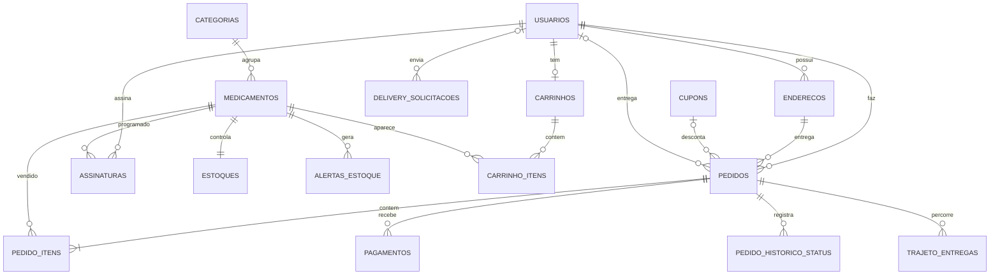

# Etapa 7 — Projeto do banco de dados (MySQL 8)

Scripts em `database/`, executados nesta ordem: `01_ddl.sql`, `02_triggers.sql`,
`03_procedures.sql`, `04_seed.sql`. O arquivo `database/completo/script_completo_bemestar.sql`
junta todos para rodar de uma vez no MySQL Workbench.

## MER (diagrama entidade-relacionamento)

## Modelo lógico (principais tabelas)
| Tabela | Chave | Campos principais | Relações |
|---|---|---|---|
| usuarios | id_usuario | nome, nome_social, email (único), cpf (único), senha_hash, perfil | — |
| enderecos | id_endereco | cep, logradouro, numero, bairro, cidade, estado, principal | usuarios |
| categorias | id_categoria | nome, slug (único), icone, ordem | — |
| medicamentos | id_medicamento | nome, slug, tipo, principio_ativo, preco, validade_lote, exige_receita, uso_continuo, farmacia_popular | categorias |
| estoques | id_estoque | quantidade, quantidade_minima | medicamentos (1:1) |
| alertas_estoque | id_alerta | quantidade_atual, resolvido | medicamentos |
| cupons | id_cupom | codigo, tipo, valor, valor_minimo_pedido, limite_uso | — |
| carrinhos / carrinho_itens | id_carrinho / id_item_carrinho | quantidade, preco_unitario | usuarios, medicamentos |
| pedidos | id_pedido | status, canal, subtotal, desconto, frete, total, requer_receita | usuarios, enderecos, cupons |
| pedido_itens | id_item_pedido | nome_produto, quantidade, preco_unitario (cópias do momento da compra) | pedidos, medicamentos |
| pedido_historico_status | id_historico | status_anterior, status_novo, alterado_em | pedidos |
| pagamentos | id_pagamento | metodo, status, valor, codigo_transacao | pedidos |
| assinaturas | id_assinatura | nome_paciente, quantidade, periodicidade_dias, desconto_percentual, proxima_entrega | usuarios, medicamentos |
| delivery_solicitacoes | id_delivery | nome_cliente, telefone, endereco_texto, receita_arquivo, status | usuarios (opcional) |
| trajeto_entregas | id_ponto | latitude, longitude, registrado_em | pedidos |

Colunas da entrega em `pedidos`: `id_entregador` (FK para usuarios com perfil ENTREGADOR),
`entregador_latitude`, `entregador_longitude`, `localizacao_em` e `receita_conferida`.
Em `enderecos`: `latitude` e `longitude`.

## Modelo físico
Ver `01_ddl.sql`: tipos (`DECIMAL(10,2)` para dinheiro, `ENUM` para status), `CHECK` (preço e
estoque não negativos, periodicidade 15/30/60/90), chaves estrangeiras com `ON DELETE`, índices
(status, data, usuário, validade) e índice `FULLTEXT` para busca. A view `vw_pedidos_completos`
junta pedido + cliente + endereço + pagamento para relatórios.

## Triggers (`02_triggers.sql`)
| Trigger | Quando | O que faz |
|---|---|---|
| trg_pedido_itens_bi_valida_estoque | antes de inserir item | bloqueia (SIGNAL) se não houver estoque |
| trg_pedido_itens_ai_baixa_estoque | depois de inserir item | dá baixa no estoque e cria alerta de reposição |
| trg_pedidos_ai_historico | depois de inserir pedido | grava o primeiro status (rastreamento) |
| trg_pedidos_au_status | depois de alterar pedido | grava cada mudança de status e devolve estoque se cancelado |
| trg_pedidos_au_trajeto | depois de alterar pedido | grava cada nova posição do entregador em trajeto_entregas |

## Procedures (`03_procedures.sql`)
| Procedure | Uso |
|---|---|
| sp_relatorio_vendas(inicio, fim) | gráfico de faturamento do painel |
| sp_produtos_estoque_baixo() | lista de compras |
| sp_produtos_vencendo(dias) | controle de validade |
| sp_proximas_entregas_assinatura(dias) | roteiro de separação das assinaturas |

A API chama as três primeiras em `Infraestrutura/Automacoes/Relatorios.cs`.
